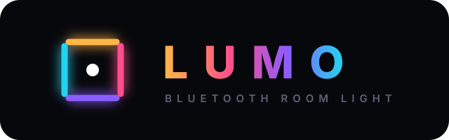
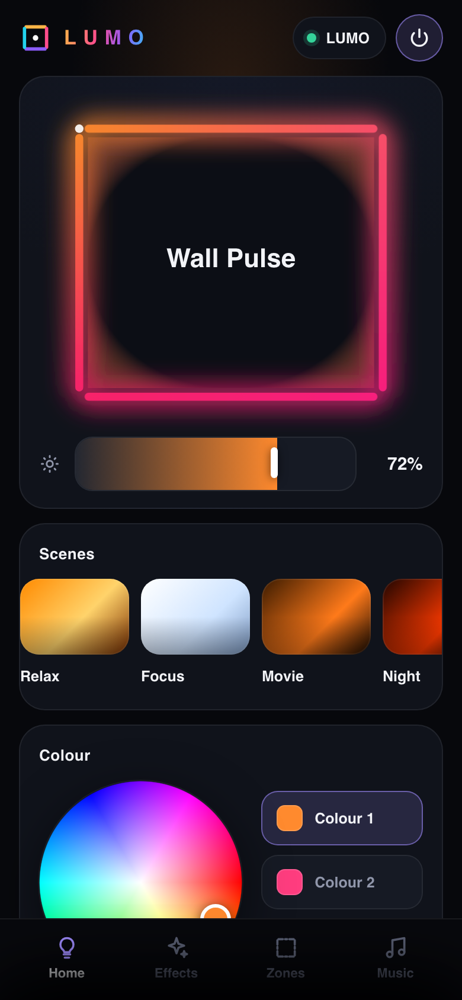
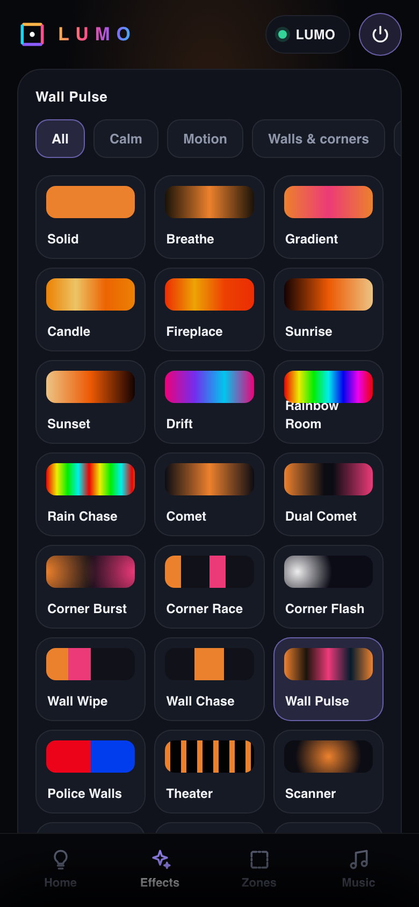
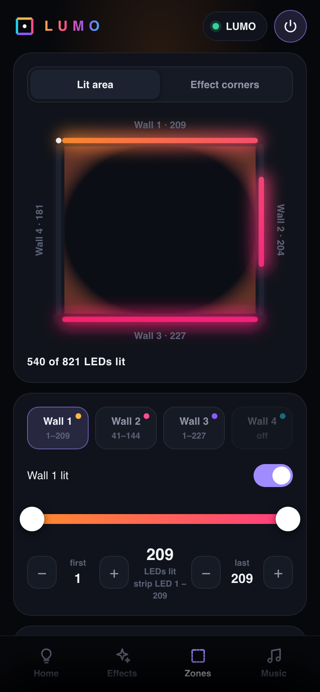
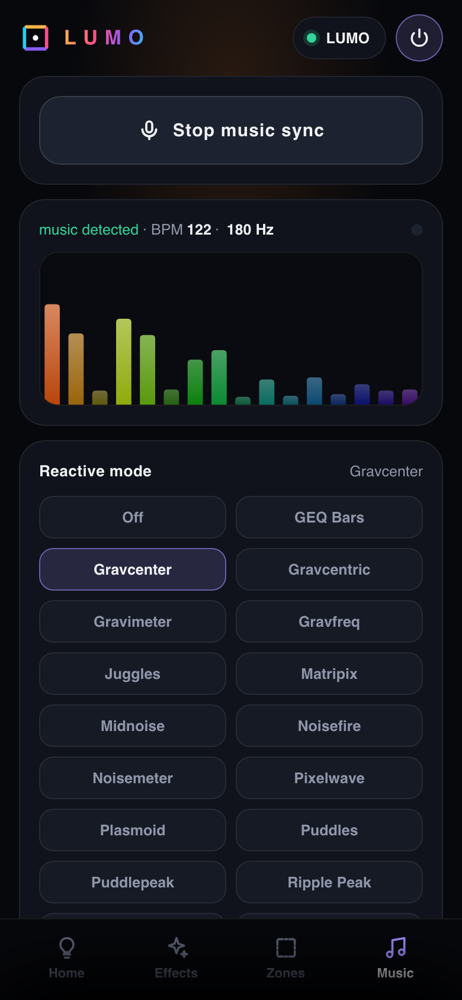
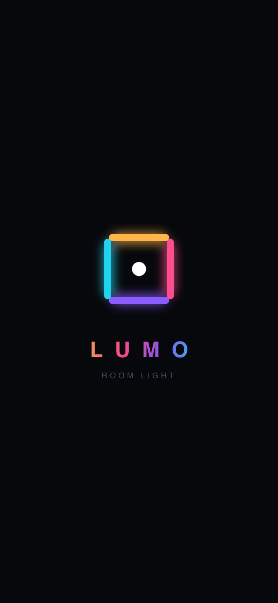
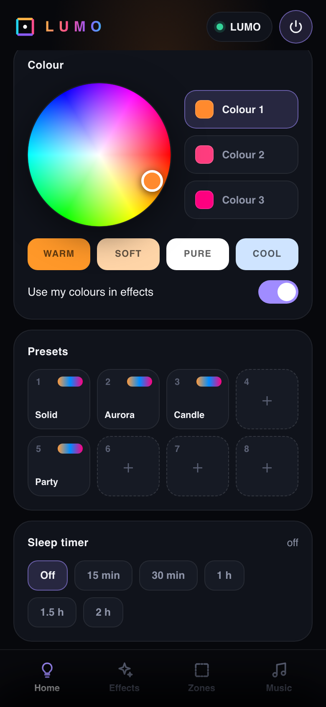
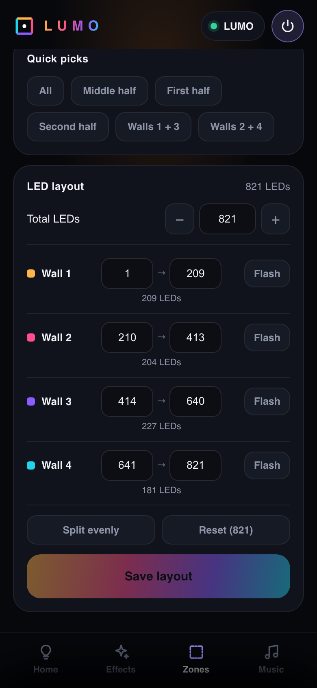
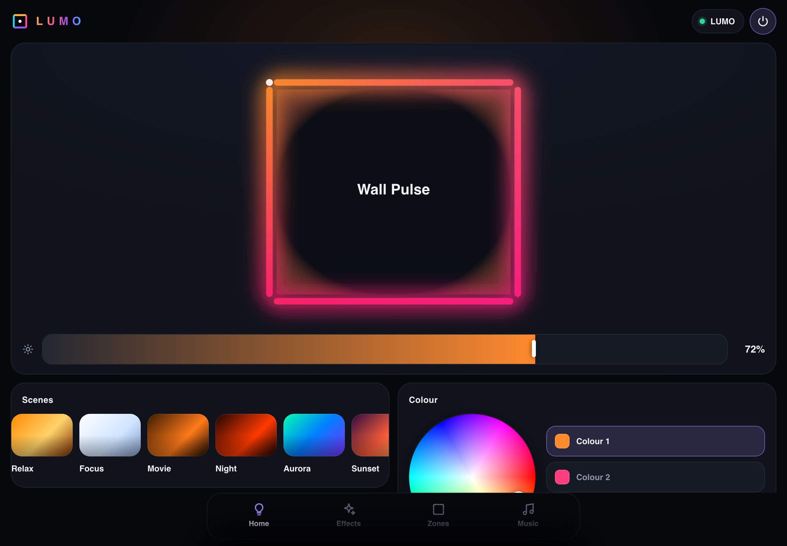

<p align="center">
  
</p>

<p align="center">
  <b>Room lighting you control from your phone over Bluetooth.</b><br>
  An ESP32-C6 drives the LED strip around your ceiling. A dark, minimal Android app controls it.<br>
  No Wi-Fi, no cloud, no account.
</p>

<p align="center">
  
  
  
  
  
</p>

<p align="center">
  &nbsp;
  &nbsp;
  &nbsp;
  
</p>

---

## Features

| | |
|---|---|
| 🎨 **Colour** | Colour wheel, three colour slots, one-tap whites, brightness **0–100 %**. Colours stay true even when dim. |
| ✨ **50 effects** | Including 12 made for a ceiling loop: Pacifica, Borealis, Night Sky, Lava Lamp, Fireflies, Ping Pong, Corner Meet… Grouped as Calm, Motion, Walls & corners, and Party. |
| 🎬 **Scenes** | One tap each: Relax · Focus · Movie · Night · Aurora · Sunset · Party · Blackout |
| 🧱 **Exact ranges** | Pick the lit part of every wall to the LED, with a two-handle slider and ±1 nudges. Switch walls on or off. |
| 📐 **LED layout** | Set the total LED count and a first → last range per wall from the app. **Flash** shows exactly where a wall sits. |
| 🎵 **Music sync** | The phone listens and the room reacts. 24 reactive modes, keeps running with the screen off. |
| 💾 **Presets** | 8 slots stored **on the controller**, shown with their colours, synced to every phone. |
| 🌙 **Sleep timer** | Fades out over the last minute and shows the minutes left. |
| 📱 **Any screen** | Phones and tablets, portrait and landscape, Android 8 through 16 |
| 🔒 **Offline** | No internet permission. The UI ships inside the APK. |
| 🔄 **Updates over Bluetooth** | New firmware installs from the phone, with CRC check and automatic rollback. |
| 🌙 **Standby** | Power off really idles the controller, and **On** works instantly. |

<details>
<summary><b>More screens</b></summary>
<br>
<p align="center">
  &nbsp;
  &nbsp;
  
</p>
<p align="center">
  
</p>
</details>

---

## Quick start

1. **Wire it.** Strip data goes to **D9** on a Seeed XIAO ESP32-C6. Power the strip from its own 5 V supply and share ground with the board.
2. **Flash the firmware.** Use `release/LumoLED-fw11-merged.bin`, or build it yourself. See **[firmware/](firmware/)**.
3. **Install the app.** Copy `release/Lumo-2.2.apk` to the phone and open it.
4. **Connect.** Allow Bluetooth access, then tap **LUMO** in the list.
5. **Set your room.** Under **Zones → LED layout**, enter your LED count and each wall's range, and use **Flash** to check them.

> [!NOTE]
> Google Play Protect warns about any app installed from outside the Play Store.
> Tap **More details → Install anyway**.

---

## Hardware

| | |
|---|---|
| **Controller** | Seeed XIAO ESP32-C6 (RISC-V 160 MHz, BLE 5) |
| **LEDs** | WS2812B @ 5 V, 8 – 1500 px (reference room: 821 px on 4 walls) |
| **Data** | D9 / GPIO 20 → **74AHCT125** level shifter → 330 Ω → DIN |
| **Power** | 5 V PSU, injected at the start of each wall, common ground |
| **Budget** | 821 px worst case **16.9 A** (39 % ceiling + colour correction); FastLED limiter caps at `PSU_MILLIAMP` |
| **Timing** | SPI + DMA driven (glitch-proof next to BLE), 30 µs/px → 36 fps at 821 px, 21 fps at 1500 px |

Wiring diagram, power and voltage-drop tables, signal integrity, render pipeline,
NVS layout and fail-safes are in **[docs/HARDWARE.md](docs/HARDWARE.md)**.

---

## Control from any BLE app

The controller understands short text commands. The app sends exactly these, so
you can also script it or drive it from **nRF Connect** (write to the RX characteristic).

| Do | Send |
|---|---|
| On / off / instant blackout | `P1` · `P0` · `Z` |
| Brightness 40 % | `B40` |
| Colour 1 warm white | `CFF9829` |
| Effect: Borealis | `M41` (0–49, see the list) |
| Speed / intensity | `S90` · `I170` |
| Only walls 1 + 3 | `X5` |
| Wall 2: light LEDs 41–144 only | `g2,40,143` |
| Flash wall 3 to find it | `F3` |
| Sleep in 30 min | `T30` |
| Save / recall preset 1 | `V0` · `W0` |
| Controller report · test pattern | `!info` · `!test` |

Full list with value ranges, effect / palette / music IDs, replies and more examples:
**[docs/PROTOCOL.md](docs/PROTOCOL.md)**.

---

## How it works

```
┌──────────────┐   Bluetooth LE (Nordic UART)   ┌────────────────┐   data (D9)   ┌──────────────┐
│  Android app │ ─────────────────────────────> │  XIAO ESP32-C6 │ ────────────> │ WS2812B strip │
│  UI + mic    │ <── state · presets (JSON) ─── │  effects · NVS │               │  4 walls      │
└──────────────┘                                └────────────────┘               └──────────────┘
```

- The **controller does the work.** Effects run on the board and keep going after the phone leaves.
- The **phone listens.** Music analysis happens on the phone, and only 24 bytes per frame go to the board.
- **Every connect resyncs.** The app reads the full state and presets from the board each time, so two phones never disagree.
- **Reliable link.** Serialised writes, a heartbeat, automatic reconnect with backoff, and a 10-minute background hold so switching apps doesn't drop it.

The full command set is in **[docs/PROTOCOL.md](docs/PROTOCOL.md)**, and the firmware internals are in **[docs/HARDWARE.md](docs/HARDWARE.md#6-firmware-architecture)**.

---

## Repository layout

```
.
├── android/            Android app (Kotlin, no dependencies)       → android/README.md
├── firmware/LumoLED/   ESP32-C6 firmware (Arduino, FastLED)        → firmware/README.md
├── release/            ready-to-install APK and firmware binaries
└── docs/               HARDWARE.md · PROTOCOL.md · logo · screenshots
```

## Building

| Part | Needs | Command |
|---|---|---|
| Firmware | esp32 core **3.3.x**, FastLED **3.9.16** | `arduino-cli compile -b esp32:esp32:XIAO_ESP32C6 firmware/LumoLED` |
| App | JDK 17, Kotlin, Android SDK 36 | `cd android && ./build_apk.sh`, or open `android/` in Android Studio |

Signing keys are **not** in this repository. Copy `android/keystore.properties.example`
to `android/keystore.properties` and point it at your own key.

---

<p align="center"><sub>Made by <b>4Brains</b> · © 2026 4Brains. All rights reserved.</sub></p>
